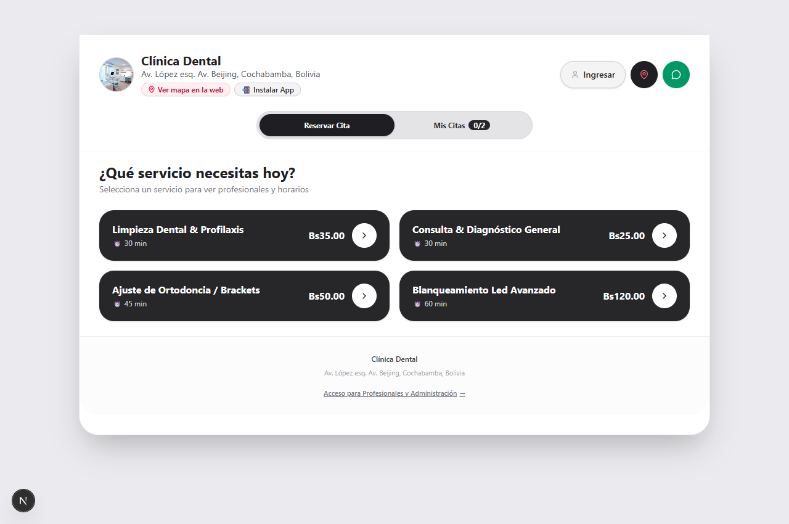
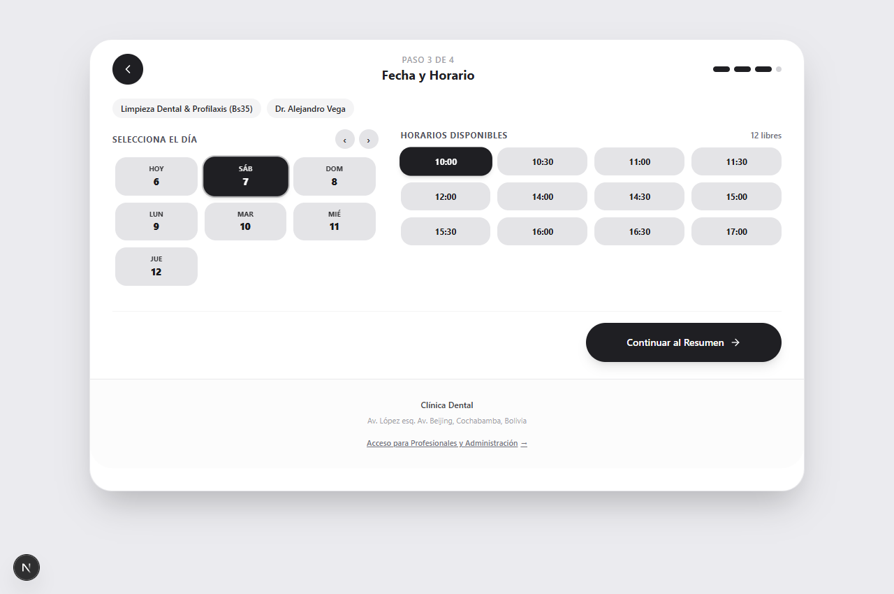
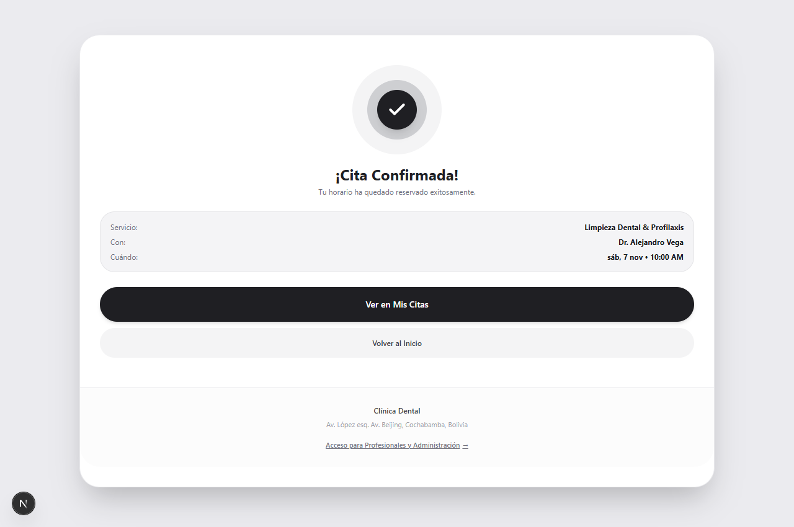
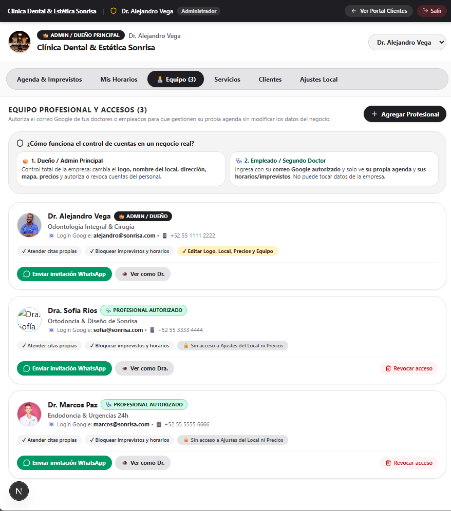
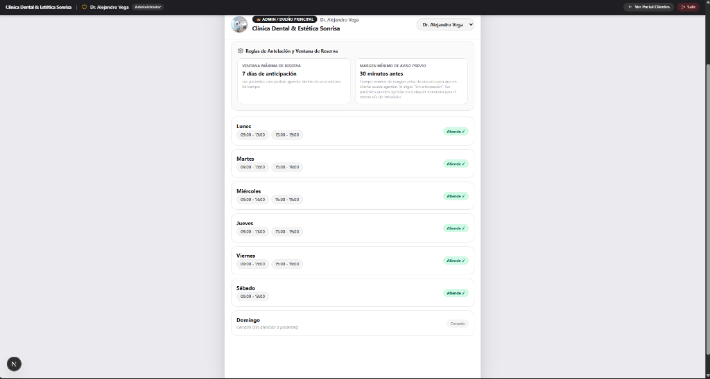
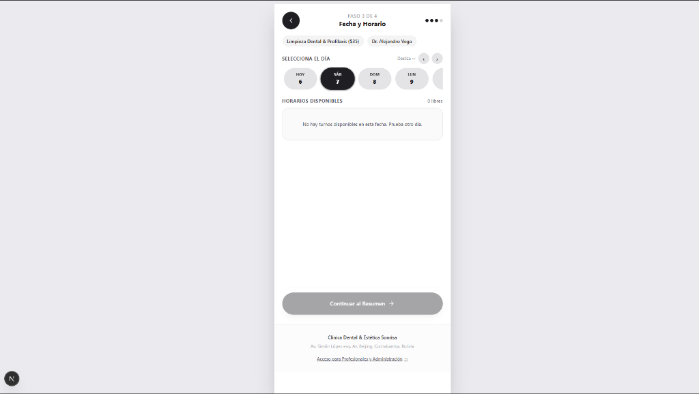

# 🌟 Reservas App — Plataforma White-Label de Gestión de Citas y Reservas Multi-Profesional

[](https://nextjs.org/)
[](https://www.typescriptlang.org/)
[](https://tailwindcss.com/)
[](https://www.prisma.io/)
[-green?logo=playwright)](https://playwright.dev/)
[](https://web.dev/progressive-web-apps/)
[](LICENSE)

> Una solución integral, moderna y modularizada para la reserva y gestión inteligente de turnos multi-profesional. Diseñada con arquitectura desacoplada y marca blanca para adaptarse con un clic a **Clínicas Odontológicas y Médicas, Barberías, Salones de Belleza, Spas, Estudios de Tatuaje y Centros de Fitness**.

---

## 📸 Galería Visual del Sistema

| 1. Portal Público y Catálogo (Desktop & Mobile) | 2. Selector de Horarios Libres en Tiempo Real |
| :---: | :---: |
|  |  |
| **3. Confirmación Atómica con Concentric Circles** | **4. Gestión de Equipo y Permisos RBAC** |
|  |  |
| **5. Agenda Diaria e Imprevistos 1-Toque** | **6. Configuración de Jornadas y Horarios** |
|  |  |

---

## ⚡ Características Principales y Lógica de Negocio

### 👤 Portal del Cliente (Front-Office)
- **Flujo de Reserva en 4 Pasos Sin Fricción:** Catálogo de servicios $\to$ Selección de profesional $\to$ Selección de fecha y hora $\to$ Confirmación con teléfono y contraseña cifrada.
- **Asignación Inteligente `"Cualquier Profesional"` (`ANY`):** Algoritmo que balancea automáticamente los turnos entre los especialistas disponibles en el horario elegido.
- **Gestión de Mis Citas:** Vista de citas confirmadas, reprogramadas o canceladas con acordeón colapsable de **Historial de citas pasadas y archivo**.
- **Avisos Instantáneos por WhatsApp:** Enlace con un toque a `https://wa.me/` con el mensaje pre-cargado con fecha, hora y servicio.
- **Progressive Web App (PWA):** Soporta instalación como aplicación nativa en Android, iOS y Desktop con `manifest.webmanifest` y Service Worker.

### 🛡️ Panel de Gestión y Control Administrativo (`/admin`)
- **Control de Acceso Basado en Roles (RBAC):**
  - `👑 ADMIN / DUEÑO PRINCIPAL`: Control total sobre datos del local, logotipo, catálogo de precios, reglas de aviso, jornadas y altas/bajas de personal.
  - `🩺 PROVIDER (Médico / Barbero / Colaborador)`: Acceso restringido exclusivamente a su propia agenda, asistencias e imprevistos. Invariante: tiene bloqueado el auto-agendamiento como cliente en `/`.
- **Acciones Rápidas de Imprevisto (1-Toque):**
  - *Entrar más tarde hoy* (retraso programado).
  - *Salir antes / Cumpleaños* (cierre anticipado).
  - *Cerrar día completo* (bloqueo total con cancelación segura de citas afectadas y notificación al cliente).
  - *Reabrir horario*: botón de desbloqueo inmediato para restaurar turnos.
- **Filtro de Agenda Multi-Doctor y `"👥 Todo el equipo"`:** Vista individual por profesional o consolidada de toda la clínica.
- **Sistema Anti-Acaparamiento (Anti-Hoarding):** Límite configurable de máximo **2 citas activas por paciente**.
- **Sistema Anti-Trolls (2 Strikes):** Si un cliente acumula 2 faltas registradas (`NO_SHOW`), su cuenta queda bloqueada automáticamente para nuevas reservas web.
- **Configuración de Marca Blanca Dinámica:** Adaptación total de la terminología (`staffLabel`), moneda, márgenes de anticipación y tiempos de buffer.

---

## 🏗️ Arquitectura y Tecnologías

```
reservas-app/
├── docs/                       # Documentación técnica completa y diagramas C4
│   ├── ARCHITECTURE.md         # Diagramas C4 (Context, Container, Component, Deployment)
│   ├── DATABASE.md             # Modelo relacional, diccionario de datos y migración
│   ├── REQUIREMENTS.md         # Requerimientos funcionales, no funcionales y bugs resueltos
│   ├── FLOWS.md                # Diagramas de secuencia de algoritmos clave
│   └── screenshots/            # Capturas de pantalla curadas en alta resolución
├── src/
│   ├── app/                    # Next.js App Router (Páginas y Endpoints REST)
│   │   ├── api/                # Controladores API (/availability, /appointments, /admin/*)
│   │   ├── admin/              # Panel administrativo con protección de roles
│   │   └── page.tsx            # Portal público de reservas para clientes
│   ├── components/             # Componentes React interactivos (Tailwind CSS 4)
│   │   ├── ClientApp.tsx       # Flujo de reserva y portal de citas del paciente
│   │   ├── AdminApp.tsx        # Dashboard administrativo y agenda médica
│   │   └── BranchMap.tsx       # Modal de mapa georreferenciado Leaflet/OpenStreetMap
│   └── lib/                    # Motores desacoplados de lógica de negocio pura
│       ├── slot-engine.ts      # Generador de slots, horas pasadas y lead time
│       ├── booking-rules.ts    # Invariantes temporales, anti-solapamiento y cancelaciones
│       ├── session.ts          # Manejo de cookies HttpOnly seguras
│       └── prisma.ts           # Singleton tipado del cliente Prisma ORM
├── prisma/
│   ├── schema.prisma           # Esquema relacional agnóstico (SQLite / PostgreSQL)
│   └── seed.ts                 # Datos iniciales realistas para pruebas inmediatas
└── tests/                      # Suite integral de pruebas automatizadas
    ├── acceptance-criteria.test.ts # 16 pruebas unitarias de invariantes temporales
    ├── e2e-full-system.test.ts     # 38 pruebas de integración API y endpoints
    └── playwright-suite.ts         # 31 pasos en navegador Google Chrome real (Playwright)
```

---

## 🚀 Inicio Rápido (Desarrollo Local)

### 1. Clonar el repositorio e instalar dependencias
```bash
git clone https://github.com/tu-usuario/reservas-app.git
cd reservas-app
pnpm install
```

### 2. Configurar variables de entorno
```bash
cp .env.example .env
```

### 3. Inicializar base de datos y cargar datos semilla
```bash
pnpm prisma db push
pnpm tsx prisma/seed.ts
```

### 4. Iniciar servidor de desarrollo
```bash
pnpm dev
```
Abre en tu navegador:
- **Portal de Pacientes:** `http://localhost:3000`
- **Panel de Gestión / Admin:** `http://localhost:3000/admin`

---

## 🔐 Cuentas de Acceso Pre-configuradas (Seed)

| Rol | Nombre | Correo (`email`) | Contraseña | Perfil y Permisos |
| :--- | :--- | :--- | :--- | :--- |
| **Admin / Dueño** | Dr. Alejandro Vega | `alejandro@sonrisa.com` | `Admin123!` | Acceso total a ajustes, local, equipo y agenda |
| **Doctora (Empleado)** | Dra. Sofía Ríos | `sofia@sonrisa.com` | `Doctor123!` | Ortodoncia • Agenda propia e imprevistos |
| **Doctor (Empleado)** | Dr. Marcos Paz | `marcos@sonrisa.com` | `Doctor123!` | Endodoncia y Madrugadas • Agenda propia |
| **Cliente / Paciente** | Carlos Mendoza | `carlos@ejemplo.com` | `123456` | Portal público de citas e historial |

---

## 🧪 Pruebas Automatizadas y Calidad de Código

El repositorio cuenta con una cobertura de pruebas exhaustiva que evalúa lógica matemática de horarios, base de datos y navegación real en navegador:

```bash
# 1. Pruebas unitarias de invariantes temporales (16/16 PASS)
pnpm test

# 2. Pruebas de integración E2E de API y Base de Datos (38/38 PASS)
pnpm test:e2e

# 3. Pruebas automatizadas en navegador Chrome Real con Playwright (31/31 PASS)
pnpm tsx tests/playwright-suite.ts

# 4. Verificación de compilación de producción Next.js Turbopack
pnpm build
```

---

## 📚 Documentación Técnica Adicional

- [🏛️ Arquitectura del Sistema y Diagramas C4 (`docs/ARCHITECTURE.md`)](docs/ARCHITECTURE.md)
- [🗄️ Modelo de Base de Datos y Diccionario (`docs/DATABASE.md`)](docs/DATABASE.md)
- [📋 Requerimientos y Matriz de Errores Resueltos (`docs/REQUIREMENTS.md`)](docs/REQUIREMENTS.md)
- [🔄 Diagramas de Flujo y Secuencia Mermaid (`docs/FLOWS.md`)](docs/FLOWS.md)

---

## 🌐 Despliegue en Producción

### Base de Datos en la Nube (PostgreSQL Serverless)
1. Crea una base de datos gratuita en [Neon.tech](https://neon.tech) o [Supabase](https://supabase.com).
2. En `prisma/schema.prisma`, cambia `provider = "sqlite"` a `provider = "postgresql"`.
3. Ejecuta `pnpm prisma db push` para aplicar el esquema en producción.

### Despliegue en Vercel
1. Conecta tu repositorio de GitHub en [Vercel](https://vercel.com).
2. Agrega la variable de entorno `DATABASE_URL` con la cadena de conexión de Neon/Supabase.
3. En **Build Command** especifica: `pnpm prisma generate && next build`.
4. ¡Tu aplicación estará en línea con HTTPS, CDN global y soporte PWA activo!

---

## 📄 Licencia

Este proyecto está bajo la Licencia **MIT**. Consulta el archivo `LICENSE` para más detalles.
