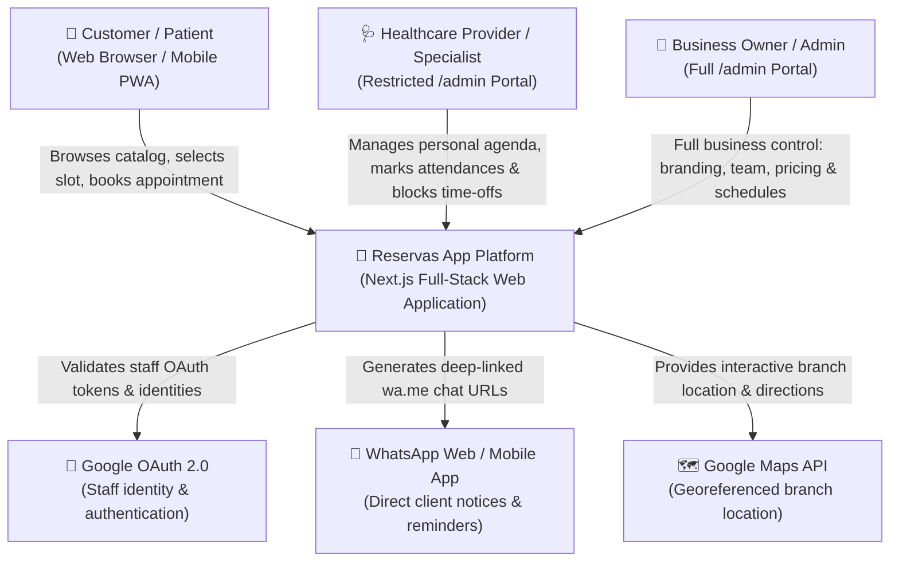
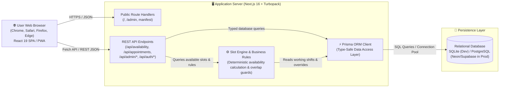
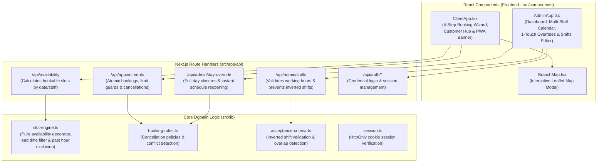
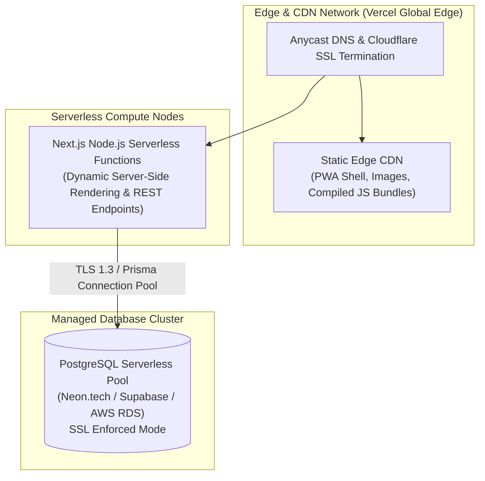

# 🏛️ System Architecture (C4 Models & Design Principles)

This document outlines the software architecture of **Sonrisa / Reservas App**, a high-concurrency multi-staff appointment booking and schedule management platform designed following the **C4 model** methodology.

---

## 1. Level 1: System Context Diagram

The System Context diagram illustrates how external actors (customers/patients, clinic providers/specialists, and business administrators) interact with the booking platform and integrated external third-party services (Google OAuth, WhatsApp, and Google Maps).

---

## 2. Level 2: Container Diagram

Describes the high-level executable software containers, network protocols, and persistence layers that comprise the running application.

---

## 3. Level 3: Component Diagram

Details the internal modular structure of frontend React components and backend API controllers.

---

## 4. Level 4: Deployment & Security Architecture

Describes the zero-trust production deployment model, secure session handling, and persistence strategies.

### 🔒 Key Architectural & Security Decisions

1. **Decoupled Business Logic (`src/lib`):**
   The core availability and validation algorithms (`slot-engine.ts`, `booking-rules.ts`, `acceptance-criteria.ts`) are pure TypeScript functions independent of the Next.js framework, enabling instant sub-second unit test execution without spinning up an HTTP server.

2. **Role Invariant Defense-in-Depth:**
   - Provider accounts (`PROVIDER`) are strictly prohibited from booking appointments as public patients in `/api/appointments` (enforced at the controller level with HTTP 403).
   - Customers (`CUSTOMER`) attempting to access administrative endpoints or role-switch routes receive an immediate HTTP 403 Forbidden.

3. **Atomic Slot Booking & Collision Prevention:**
   When booking an appointment, the system evaluates slot validity against existing database records inside an atomic verification flow. If two concurrent users attempt to book the same specialist at the exact same minute, the second request is rejected with HTTP 409 Conflict without creating ghost appointments.

4. **Session Security:**
   Administrative and customer authentication utilizes HttpOnly, SameSite=Lax session cookies that cannot be accessed by client-side JavaScript, effectively eliminating XSS-based token theft vulnerabilities.
