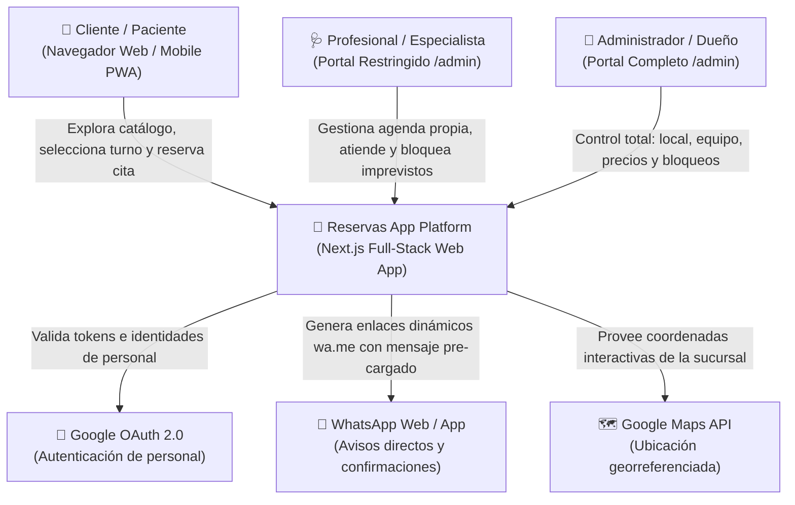
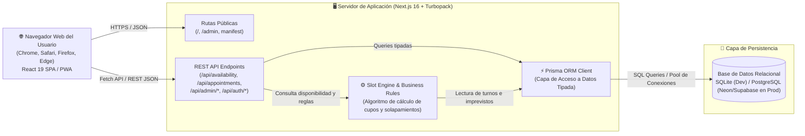
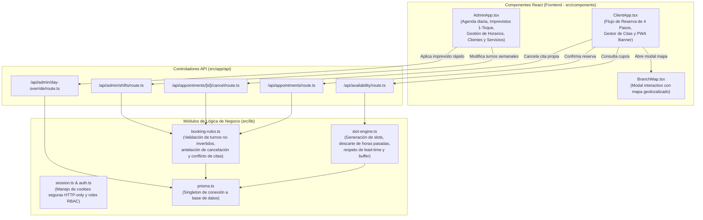
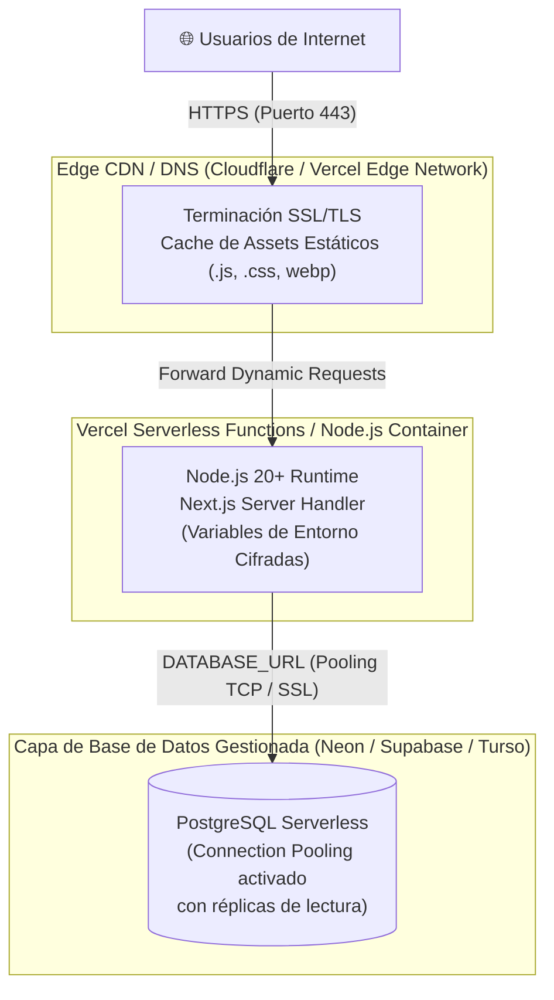

# 🏛️ Arquitectura del Sistema (Diagramas C4 y Principios de Diseño)

Este documento detalla la arquitectura de software de **Sonrisa / Reservas App**, una plataforma moderna de reservas, agendamiento y gestión de citas multi-profesional de alta concurrencia diseñada bajo la metodología de modelado **C4**.

---

## 1. Nivel 1: Diagrama de Contexto del Sistema (System Context)

El diagrama de contexto ilustra cómo los diferentes actores externos (pacientes/clientes, profesionales del equipo y administradores/dueños) interactúan con la plataforma de reservas y con servicios externos de terceros (Google OAuth, WhatsApp y Google Maps).

---

## 2. Nivel 2: Diagrama de Contenedores (Container Diagram)

Muestra los bloques de software ejecutables de alto nivel, protocolos de red y almacenamiento de datos persistentes.

---

## 3. Nivel 3: Diagrama de Componentes (Component Diagram)

Detalla la estructura interna de módulos del frontend y controladores backend.

---

## 4. Nivel 4: Diagrama de Despliegue (Deployment Diagram)

Configuración recomendada para despliegue serverless de producción en infraestructura moderna (Vercel / Cloudflare / Render + Base de Datos Gestionada).

---

## 5. Principios de Arquitectura e Invariantes Clave

1. **Invariante Temporal Estricto:**
   - La hora de fin de un turno de trabajo siempre debe ser posterior a la hora de inicio ($T_{fin} > T_{inicio}$). El sistema rechaza inmediatamente tanto en frontend como en API turnos invertidos (ej. 20:00 a 19:00).
2. **Alineación con Fecha Local del Negocio:**
   - Para evitar desfases de un día por zonas horarias UTC, todas las operaciones de fecha usan formateadores basados en tiempo local (`formatLocalDateYYYYMMDD`).
3. **Control de Acaparamiento (Anti-Hoarding):**
   - Ningún paciente puede tener más de **2 citas activas simultáneas**.
4. **Política Anti-Trolls (2 Strikes):**
   - Un cliente con 2 faltas registradas (`NO_SHOW`) es bloqueado automáticamente de la plataforma (`isBlocked: true`).
5. **Separación de Roles (RBAC):**
   - Las cuentas profesionales (`PROVIDER`) tienen prohibido auto-agendarse como pacientes. Tienen su panel exclusivo en `/admin`.
