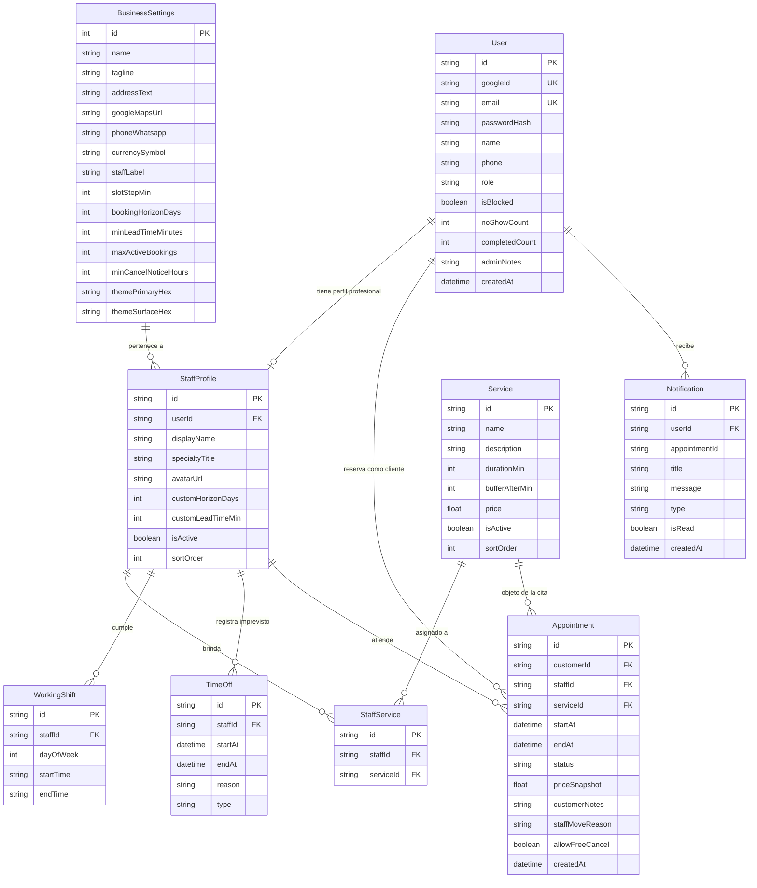

# 🗄️ Modelo de Base de Datos y Diccionario de Datos

Este documento describe el esquema relacional, modelos de datos, índices y relaciones implementadas en **Prisma ORM**.

---

## 1. Diagrama Entidad-Relación (Mermaid ERD)



---

## 2. Diccionario de Datos

### Tabla: `User`
Almacena usuarios autenticados y clientes del sistema.
- `id` (String / CUID): Identificador único primario.
- `email` (String / Unique): Correo electrónico del usuario.
- `passwordHash` (String?): Hash bcrypt para autenticación con contraseña.
- `name` (String): Nombre completo del paciente o profesional.
- `role` (String): Rol del usuario (`CUSTOMER`, `PROVIDER`, `ADMIN`).
- `isBlocked` (Boolean): Flag de control anti-trolls / inasistencias.
- `noShowCount` (Int): Contador acumulado de faltas sin aviso.
- `completedCount` (Int): Total de citas asistidas exitosamente.

### Tabla: `StaffProfile`
Perfil público y atributos de cada especialista o colaborador.
- `id` (String / CUID): Identificador del perfil.
- `userId` (String? / Unique): Relación 1:1 con la cuenta `User`.
- `displayName` (String): Nombre profesional visible (ej. *"Dr. Alejandro Vega"*).
- `specialtyTitle` (String): Título o especialidad (ej. *"Odontología Integral"*).
- `isActive` (Boolean): Indica si el profesional está habilitado para recibir citas.
- `sortOrder` (Int): Orden de presentación en el catálogo.

### Tabla: `WorkingShift`
Horarios habituales de atención por día de la semana.
- `dayOfWeek` (Int): Día de la semana (0 = Domingo, 1 = Lunes, ..., 6 = Sábado).
- `startTime` (String): Hora de inicio en formato `HH:mm` (ej. `"09:00"`).
- `endTime` (String): Hora de fin en formato `HH:mm` (ej. `"13:00"`). Invariante: `endTime > startTime`.

### Tabla: `TimeOff`
Bloqueos temporales e imprevistos de agenda.
- `type` (String): Tipo de imprevisto (`LATE_START`, `EARLY_LEAVE`, `FULL_DAY_OFF`).
- `startAt` (DateTime): Inicio exacto del bloqueo.
- `endAt` (DateTime): Fin exacto del bloqueo.
- `reason` (String): Motivo visible para el paciente y la administración.

### Tabla: `Appointment`
Registro transaccional de reservas.
- `startAt` (DateTime): Fecha y hora de inicio de la cita.
- `endAt` (DateTime): Fecha y hora de fin (calculada con duración + buffer).
- `status` (String): Estado de la cita (`CONFIRMED`, `COMPLETED`, `NO_SHOW`, `NO_SHOW_ARCHIVED`, `CANCELLED`, `RESCHEDULED_BY_STAFF`).
- `priceSnapshot` (Float): Precio del servicio al momento de la reserva (evita cambios retroactivos).
- `allowFreeCancel` (Boolean): Excepción de cancelación gratuita por imprevisto del médico.

---

## 3. Estrategia de Migración a Producción

El proyecto utiliza actualmente SQLite local (`file:./dev.db`) para máxima velocidad y cero fricción en desarrollo local.

Para desplegar en servicios serverless gratuitos en producción:

### Opción A: PostgreSQL Serverless (Neon o Supabase)
1. Modificar en `prisma/schema.prisma`:
   ```prisma
   datasource db {
     provider = "postgresql"
     url      = env("DATABASE_URL")
   }
   ```
2. Ejecutar migración:
   ```powershell
   pnpm prisma migrate dev --name init_postgres
   pnpm prisma db seed
   ```

### Opción B: Turso (LibSQL Serverless Edge)
Compatible de forma nativa con el esquema SQLite actual mediante `@prisma/adapter-libsql`.
