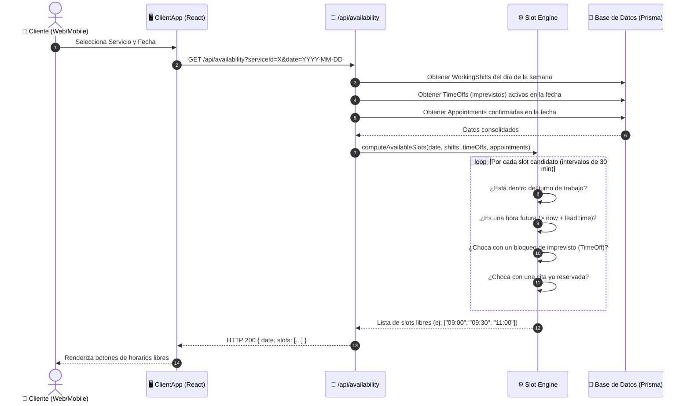
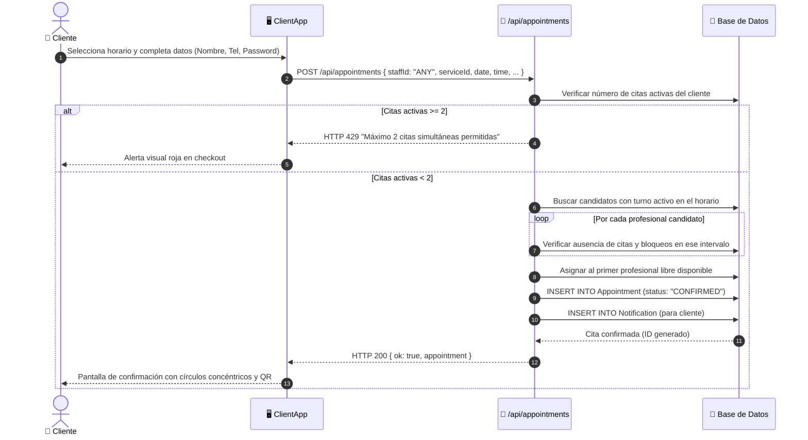
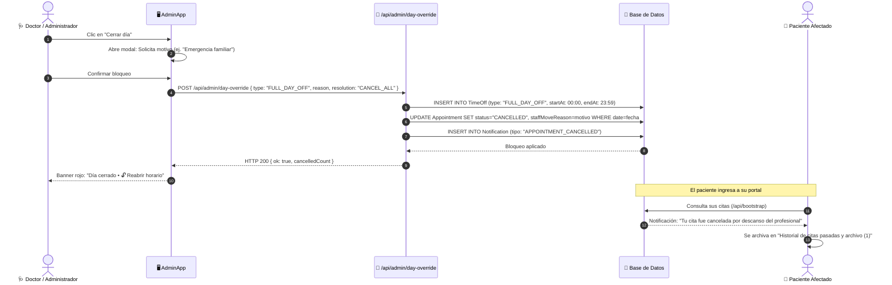
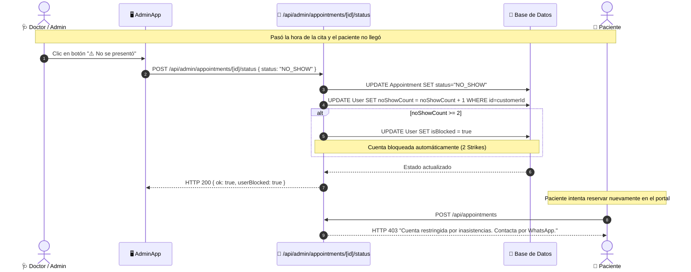

# 🔄 Diagramas de Flujo y Secuencia del Sistema

Este documento describe los flujos operativos y transaccionales del sistema modelados mediante **Diagramas de Secuencia Mermaid**.

---

## 1. Flujo de Consulta y Cálculo de Disponibilidad (`Slot Engine`)

Describe cómo el motor de slots evalúa turnos semanales, imprevistos y citas existentes para producir exclusivamente los horarios libres válidos.

---

## 2. Flujo de Reserva Atómica con Asignación Balanceada (`staffId="ANY"`)

Muestra la resolución automática del profesional cuando el paciente elige "Cualquier Profesional disponible".

---

## 3. Flujo de Imprevisto "Cerrar día" y Resolución de Colisiones

Muestra cómo el médico bloquea su agenda y qué sucede con las citas afectadas.

---

## 4. Flujo de Control Anti-Trolls (Strikes de Inasistencias y Bloqueo)

Muestra la protección contra clientes que no se presentan a sus citas sin previo aviso.

