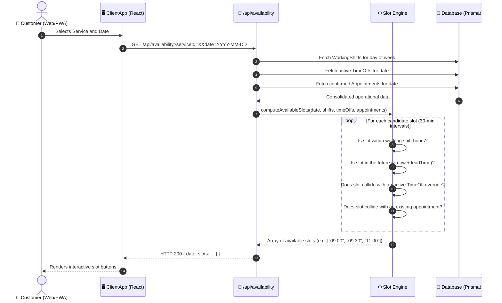
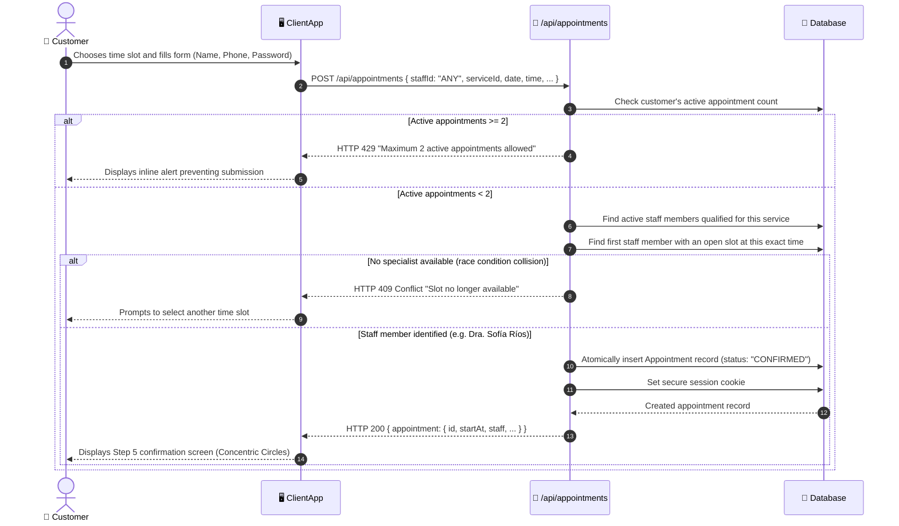
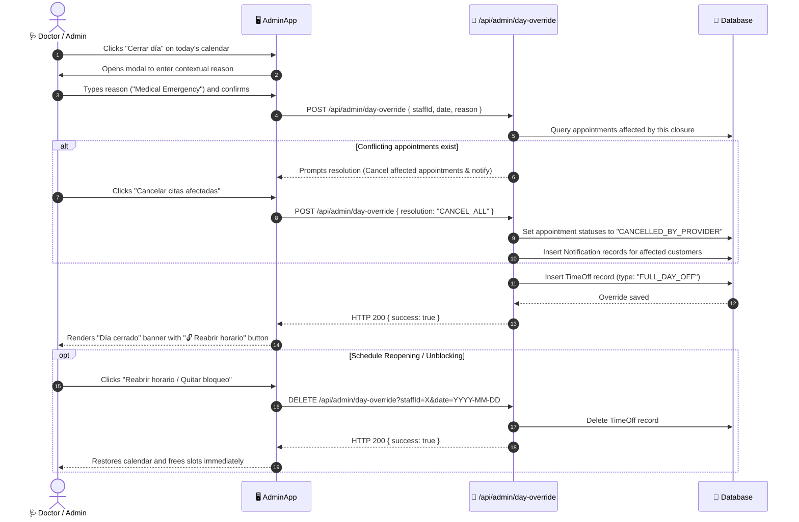
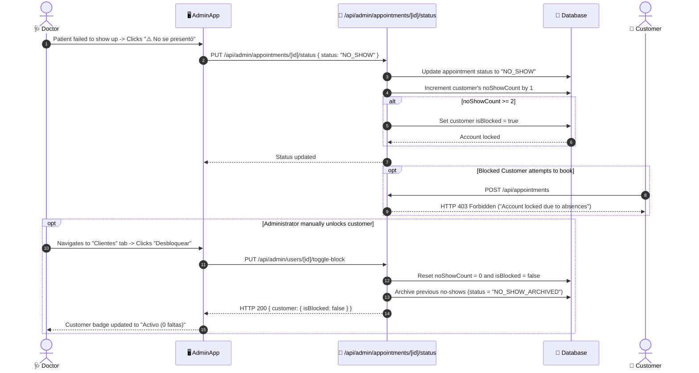

# 🔄 System Sequence Diagrams & Operational Flows

This document details the core operational and transactional workflows of the system modeled using **Mermaid Sequence Diagrams**.

---

## 1. Availability Calculation Flow (`Slot Engine`)

Describes how the slot engine evaluates weekly working shifts, schedule overrides, and existing appointments to compute purely valid, non-colliding bookable slots.

---

## 2. Atomic Booking Flow with Balanced Assignment (`staffId="ANY"`)

Shows how the system resolves specialist assignment when the customer selects "Any Available Staff".

---

## 3. 1-Touch Unplanned Schedule Override Flow (`Close Day`)

Illustrates the full day closure procedure, collision detection, and instant unblocking/reopening.

---

## 4. Anti-Troll Control & Account Re-activation Flow (2-Strike System)

Details how unexcused absences trigger automated account locks and the subsequent administrator reset flow.

